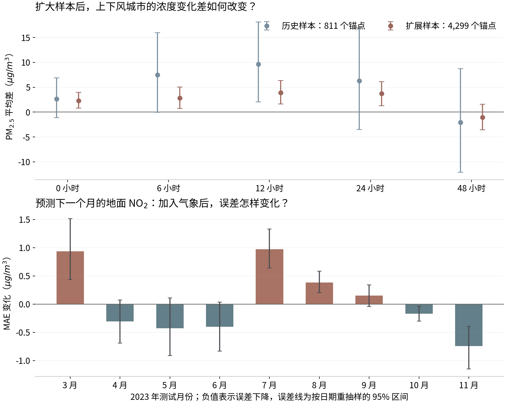
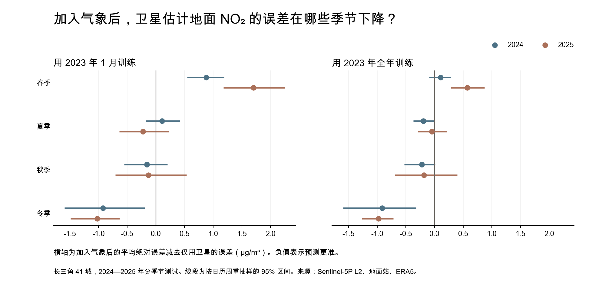

# 中国城市重污染日从哪里来？

**研究问题。** 2023—2025 年，长三角城市的重污染日集中在何时、何地？结合地面、卫星和气象观测，我们能解释哪些污染过程，又能在什么条件下更准确地估计地面 NO₂？

2023—2025 年，在长三角 41 城的 **44,115 个合格城市日**中，PM₂.₅ 日均严格超过 150 µg/m³ 的有 **159 个**，分布在 **34 个日期**。三年 6 月、10 月和 11 月合计 **10,898 个合格城市日，超阈值为零**。这些月份用来近似麦收和秋收窗口，各地实际收获和焚烧日期有差异。零次超阈值描述的是合格城市日达到上述浓度的频率。较低浓度下也可能有焚烧贡献。另一条直接的来源线索出现在 **2023 年 3 月 23 日**：五个超阈值城市的地面粗颗粒在凌晨陡升，同日苏皖地区有沙尘监测记录。

**空间上集中在皖北和苏北。** 皖北六市为蚌埠、淮北、亳州、宿州、阜阳、淮南，苏北五市为徐州、连云港、宿迁、淮安、盐城。这 11 城占全部合格城市日的 26.8%（11,837/44,115），占超阈值城市日的 61.6%（98/159）。阜阳 17 个、徐州 12 个、亳州和淮北各 11 个。南京有 1,077 个合格日，最高日均 129.16 µg/m³。地理位置提供了考察跨地区输送的线索，气团路径仍需独立核验。

全国地面小时档已覆盖全部 1,096 个日历日，其中 1,077 天至少有一城达到每日 20 个有效小时的门槛。各项多源实验按实际可匹配的城市、日期、变量计数。[原项目计划书](项目计划书.pdf) · [三年分析输入清单](../三年地面扩展/分析输入逐日清单.csv)

## 一　卫星发现火点后，下风城市的 PM₂.₅ 比上风城市多升多少？

**配对后，第 12 小时额外升幅为 +1.45 µg/m³，95% 区间为 [−1.98, +4.99]。** 1,566 个事件找到了同一网格、同一钟点且风况相近的未检出日。对每座城市，先用第 12 小时的浓度减去事前 24 小时均值，再比较下风组和上风组。在这批匹配成功的事件中，火点日的上下风差平均为 +3.252 µg/m³，未检出日也有 +1.806 µg/m³。逐对相减后平均为 +1.446 µg/m³。按年月整块重抽样 10,000 次所得的区间包含零，现有样本尚不足以确认火点日有额外升幅。[逐事件配对](../三年地面扩展/同网格未检出日配对.csv.gz)

筛选时，把卫星火点候选格按位置和小时合并，排除固定热源，在距火点 30—200 公里的城市中按风向选取两组。对照日来自同年同月、前后 14 天内，且该网格在对照日及前后各一天均无卫星火点记录。风向差至多 30°，风速差至多 2 m/s，同一批城市须仍在原上下风扇区且有浓度记录。多个日期合格时取最近日期，同距取风向更接近者。卫星是否检出还受云和过境覆盖影响。

全部 4,299 个事件来自 619 天。第 12 小时未扣除参照日的上下风差为 +3.91 µg/m³，按事件日期重抽样的 95% 区间为 [1.64, 6.38]。其中 3,348 个火点出现在北京时间 12—14 时，第 12 小时的观测多落在夜间。匹配成功的 1,566 个事件占 36.4%，来自 455 个事件日期。它们未经对照的差值 +3.25 略低于全部事件的 +3.91，二者不能相减来推算火点的贡献比例。全部事件在 0、6、12、24、48 小时的平均差依次为 +2.29、+2.82、+3.91、+3.75、−1.08 µg/m³。第 12 小时与第 6、24 小时直接配对比较时，差值区间均包含零。[全事件与五个时点](../三年地面扩展/火点相同锚点对照.csv)

**旧样本与农田子集。** 旧 134 日样本中的 811 个事件全部出现在新表，用补齐的地面记录复算得到 +9.59 µg/m³，接近当时的 +9.61。新增 3,488 个事件的均值为 +2.59，合并后下降到 +3.91。满足至少两个已绘农田小格条件的事件有 51 个，未经未检出日配对的平均差为 +4.37，95% 区间 [−0.46, 9.51]。地图能提示周围用地，燃烧物种类仍未知。

## 二　加入气象信息，卫星能否更准确地估计地面 NO₂？

卫星给出从地面到对流层顶的 NO₂ 柱浓度，地面站给出近地面浓度。按卫星真实过境时刻，把城市代表点周围 15 公里内的合格像元与地面、风速和边界层高度配对。以 2023 年训练两套岭回归模型，对 2024 和 2025 年的同一批城市日分别计算平均绝对误差（MAE）。误差越小，卫星估计与地面实测越接近。

**全年训练后的预测。** 表中差值为加入气象后的误差减去只用卫星的误差。两种 95% 区间均用逐城市日预测配对复算，分别按日期及按日历周整块抽样 3,000 次，保留同一天或同一周城市之间的共同波动。

|测试年|测试城市日|仅卫星 → 卫星加气象的 MAE（µg/m³）|相对降幅|差值的按日 95% 区间（µg/m³）|差值的按周 95% 区间（µg/m³）|
|---|---:|---:|---:|---:|---:|
|2024|8,499|4.73 → 4.44|6.2%|[−0.42, −0.17]|[−0.52, −0.10]|
|2025|8,926|4.88 → 4.70|3.7%|[−0.34, −0.01]|[−0.42, +0.07]|

2024 年的下降在两种抽样方式下均可观察到。2025 年下降较小，按周考虑连续天气过程后，区间包含零。仅用 2023 年 1 月训练时，两个测试年的冬季误差均降低，春季均升高，夏秋四次比较的按周区间均包含零。不同季节的效果限制了单月模型的适用范围。这项检验衡量的是卫星对过境附近地面 NO₂ 的估计能力。[跨季节实验日志](../非一月卫星补采_验收/实验日志.md) · [逐城市日预测](../非一月卫星补采_验收/结果/季节配对预测.csv.gz)

早期 2023 年一季度试验留出空间格点，加入气象后 MAE 从 6.20 降到 5.52 µg/m³。另用 307 个日期、6,933 个城市日，每次只用以前月份训练，预测次月。3—11 月九次检验中，五个月误差下降，四个月上升。[逐月误差与区间](../三年地面扩展/各月加入气象的配对误差变化.csv)

## 三　哪些城市常在同一天超阈值，能解释哪些过程？

同一城市的连续超阈值日合并为一段，共 120 段。跨城同日超阈分别计数，一次区域天气过程可以覆盖多座城市。2023、2024、2025 年分别有 89、50、20 个超阈值城市日。2023 年 12 月 28 日、12 月 31 日和 2024 年 2 月 10 日均有 16 城同日超阈值。春节与各自节前七天相比，两年均值升高、一年下降。旧聚类按风速、边界层高和上风城市前 6 小时 PM₂.₅ 分组。116 段可聚类的过程中，76 段平均风速 2.14 m/s、边界层高 246 米；其余 40 段分别为 3.41 m/s、424 米。两组上风城市前期的 PM₂.₅ 都较高（140.60、149.22 µg/m³）。聚类区分出不同扩散条件，来源贡献仍需另外检验。

### 120 段城市过程的污染物线索

34 座城市在 31 个不同日期开始了这 120 段过程，其中 91 段只持续一天。逐段比较事件小时与该城事前三天的同钟点。先保留同站、同小时同时有 PM₂.₅、PM₁₀、CO 的记录，剔除 PM₁₀ 小于 PM₂.₅ 的无效粒径组合，再计算城市小时均值。对照钟点须在前三天中至少有两天可用，每个事件日至少留有 20 个配对小时，基线至少有 48 个有效小时，还须能计算 PM₂.₅ 与 CO 的小时秩相关。有 110 段满足以上条件。其余 10 段开始于 2023 年 1 月 1—2 日，缺少研究期之前的地面对照。下表各行互斥。[逐城市过程表](../三年过程污染物线索/逐城市过程.csv) · [小时对照表](../三年过程污染物线索/过程窗城市小时.csv.gz)

|观测特征|城市过程数（共 120 段）|主规则与解释|
|---|---:|---|
|粗颗粒占优并增强|6|事件期粗颗粒占 PM₁₀ 至少 50%，且较同钟点基线上升。3 月 23 日五城和 4 月 11 日淮北入选。|
|PM₂.₅ 与 CO 同升|60|PM₂.₅ 升高，CO 增量超过其基线四分位距的一半，事件小时两者的秩相关至少 0.50。共同排放和相近的扩散条件都能产生这一现象。|
|细颗粒占优且 CO 未明显升高|27|细颗粒占 PM₁₀ 至少 65%，PM₂.₅ 升高，CO 增量不超过上述界限。区分二次生成、输送和其他细颗粒来源还需化学组分。|
|其余或信号不一致|17|资料够用，观测组合未达到上述规则。|
|资料不足|10|事前地面记录不足，保留在总分母中。|

允许粗颗粒增强与 CO 同升同时触发，主规则下两者交集为零。另算同城 NO₂/SO₂ 质量浓度比、O₃、风速和边界层高度，供比较气体构成和扩散条件。单个气体比值不足以区分机动车与燃煤排放。阈值是可复算的探索性判据。改用两套相邻判据后，粗颗粒增强始终为 6 段，PM₂.₅ 与 CO 同升为 40—66 段，细颗粒占优且 CO 未明显升高为 24—40 段。三套规则给 92 段相同的标签，其中包括 10 段资料不足。[判据和复算程序](../三年过程污染物线索/过程复算.py) · [规则敏感性](../三年过程污染物线索/规则敏感性.csv)

按起始月统计，60 段 PM₂.₅ 与 CO 同升中，1 月 28 段、2 月 6 段、12 月 26 段。27 段细颗粒占优且 CO 未明显升高的过程中，2 月最多（12 段）。6 段粗颗粒占优分布在两个日期。2023 年 4 月 11 日淮北的 PM₂.₅/PM₁₀ 为 0.214，粗颗粒相对基线增加 546.1 µg/m³。同日淮北市濉溪县生态环境分局通报，激光雷达已观测到高空沙尘抵达本市上空。这为地面粒径特征提供了独立的输送线索，地面细颗粒中的沙尘质量占比仍未测定。[逐月计数](../三年过程污染物线索/按月分布.csv) · [逐城计数](../三年过程污染物线索/按城分布.csv) · [淮北 4 月 11 日激光雷达通报](https://www.sxx.gov.cn/zwgk/public/1751/62878450.html)

**1 月初，区域向外输出减弱。** 9 段有完整事前三天组分资料的同城过程中，黑碳、有机碳和硫酸盐均升高，7 段在 1 月 6 日同时开始。1 月 2、5、6 日超阈值前 24 小时，包围研究区的矩形边界上黑碳、有机碳整层通量仍为净输出，输出比此前 48 小时弱。这与区域内物质较易留存相容，缺乏区域整体净输入增强的信号。直接检查气象，事件期相较前一天，9 段边界层均升高，8 段风速增大；因此不能将这些过程统一解释为近地面扩散变差。区域内部跨城输送、本地排放、化学转化可同时发生。[通量对照](../三年地面扩展/边界事前比较_kg每秒.csv) · [组分对照](../三年地面扩展/冬季过程对前三日.csv)

**3 月 23 日，地面站记录到一次区域沙尘影响。** 五城平均粗颗粒浓度（同站 PM₁₀ 减 PM₂.₅）从 22 日 21—24 时的 21.2，升至 23 日 03—06 时的 548.7、06—09 时的 1,094.8 µg/m³，与当日区域沙尘通报吻合。MERRA-2 的模式细沙尘提供旁证：事件日全天与前三天 72 小时相比，五城增量为 +3.91 至 +7.34 µg/m³。宿迁的 +3.91 来自 6.94361 减 3.02963，约 3.91398；火点主分析的 +3.91 来自 4,299 个事件的平均差 3.90713，两者四舍五入相同。完整窗口实际有 480 个模式城市小时，其中 470 个与地面配对，事件日 120 个全部配对。地面粗颗粒和模式细沙尘粒径不同，无法将两者直接相除来分配实测 PM₂.₅。[五城逐小时数据](../三年地面扩展/三月五城逐小时.csv) · [区域沙尘监测通报](https://m.thepaper.cn/detail/22416435)

## 原始数据规模

以下五源表保存扩展前的基线。随后完成的三年区域风场与三冬真实过境复算列在表后。

按课程说明第 3—4 页，相关有效原始数据总量原则上至少 2 GB，每个主要来源至少 200 MB，任一来源占比原则上不超过 80%。下表使用十进制 MB，对本地落盘文件大小与 SHA-256 逐一核验。有效记录、原文件和重复派生表分别列账。

|来源|同内容去重的原始文件字节|与分析直接相关的核验|
|---|---:|---|
|地面站|1,998,769,634|PM₂.₅、NO₂ 原始行共 257,074,351 字节，含行键、空项和全部站列。实际进入城市均值的有效数值文本 146,138,811 字节。按两指标原始行已过 200 MB，仅计入模数值则低于 200 MB。|
|Sentinel-5P|40,688,405|含十月 L2 试验。问题二实际 330 份区域日窗共 5,252,920 字节；匹配 6,223 个不同卫星格日。整源和本题均低于 200 MB。|
|ERA5|85,150,365|含新增边界层区域文件 12,372,984 字节。178,685 个地面匹配城市小时实际使用补值。连同既有输入仍低于 200 MB。|
|火点|558,827,644|七年全国年表；全国季节分布、区域事件和主分析分母不同。|
|地图|1,874,655,405|全国和省级快照有空间重叠，文件级去重仍不能消除地理重叠。|

五源去重文件合计 4,558,091,453 字节，含研究区域外、未用字段与空间重叠。这个总数不能作为有效数据 2 GB 或单源占比达标证明。另有 MERRA-2 一月和三月 16 份区域组分文件共 9,313,922 字节，单列为个案材料；未并入卫星或 ERA5，未累计全球传输文件。当时卫星与 ERA5 两项均有缺口。[逐文件字节与哈希](../三年地面扩展/更新原始输入校验.csv.gz) · [五源小计](../三年地面扩展/更新原始文件字节.csv)

## 网格风场和原生卫星像元的增量检验

三年网格风场新增 266,219,820 字节，ERA5 单源已超过 200 MB。三冬 142 轨 Sentinel‑5P 区域子集新增 16,478,285 字节；连同既有全部卫星文件，上限为 57.17 MB。该月度试验完成后，卫星和全项目有效规模仍需继续核算。

4,146 个共同火点事件的上下风变化差，用城市风得到 +4.02、用火点所在格的风得到 +4.06 µg/m³，配对方法差 +0.03，95% 区间 [−0.11, +0.18]。2023 年 1 月训练后，采用 L2 真实过境时刻及气象，2024 年 1 月地面 NO₂ 的 MAE 从 10.32 降至 8.38，2025 年 1 月从 9.15 降至 7.81 µg/m³，基准均为仅用 L2。[实验日志、L2 与 L3 对照、下载清单及验证结果](../网格与过境复算/实验日志.md)

## 气象信息在夏季和秋季还有帮助吗？

2023—2025 年的 36 个月共核对 1,695 个目录轨道，取得 1,694 轨，其中 1,688 份长三角 L2 区域提取文件含像元（196.28 MB），其中 1,341 轨向最终模型贡献城市日。26,229 个城市日同时具备卫星、地面和网格气象。 目录中 1 轨未纳入。用 2023 年 1 月训练，加入气象后，夏季 MAE 的变化依次为 +0.11、-0.23 µg/m³，秋季为 -0.16、-0.13 µg/m³（依次为 2024、2025 年，负值表示误差下降）。将训练期扩展到 2023 全年后，夏季差值为 -0.20、-0.04，秋季为 -0.22、-0.19。各年各季的区间按日历周重抽样。

仅按本轮三年区域提取文件，距离 200 MB 还有 3.72 MB。旧 L3 和试验档案与新 L2 覆盖有交叉，不能直接累加认定有效量。 [逐季误差、样本与限制](../非一月卫星补采_验收/实验日志.md)

## 核验和复现

[三年分析与核验说明](../三年地面扩展/README.md) · [火点对照复算](../三年地面扩展/复核火点对照.py) · [体量复核](../三年地面扩展/复核来源字节.py) · [134 日阶段报告](134日阶段报告.md) · [AI 使用与成员核验](../AI_USAGE.md)

## AI 使用和仓库

组员提出核对上下风参照、误差能否跨季节推广以及按实收字节验收。ChatGPT / Codex 实现区域采集、时间空间匹配、模型比较与程序复核。详细采纳、纠错和待成员填写的心得见 [AI_USAGE.md](../AI_USAGE.md)。

[项目 GitHub 仓库](https://github.com/gxm-nju/china-air-pollution)
