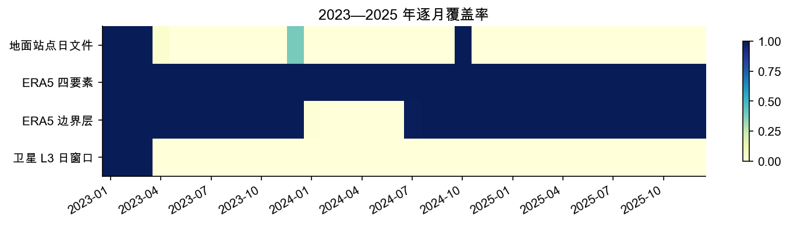
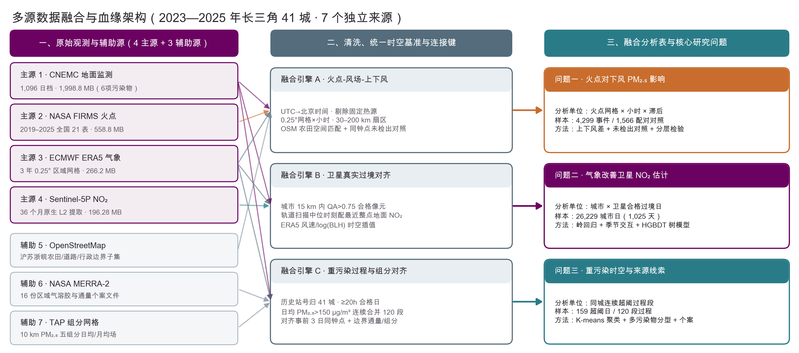
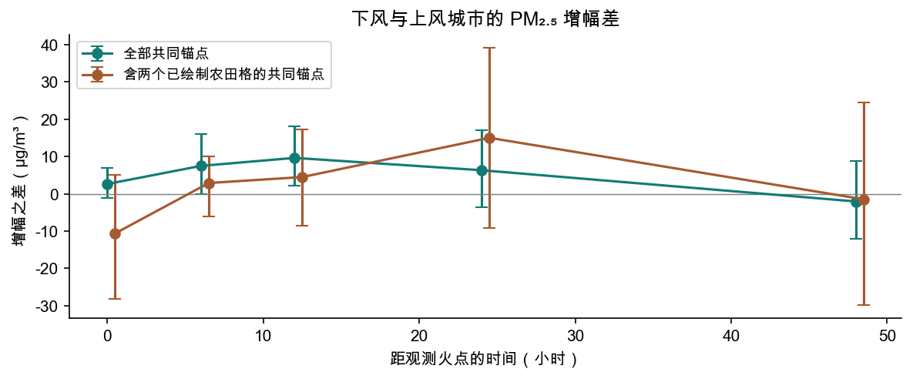
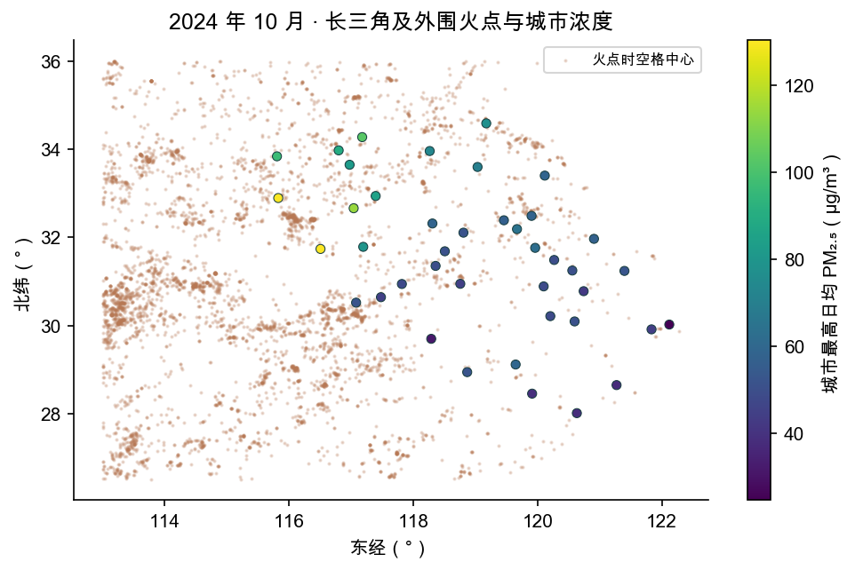
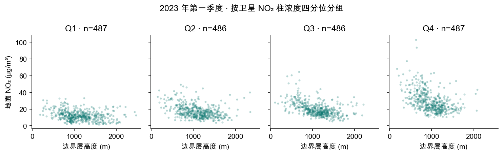
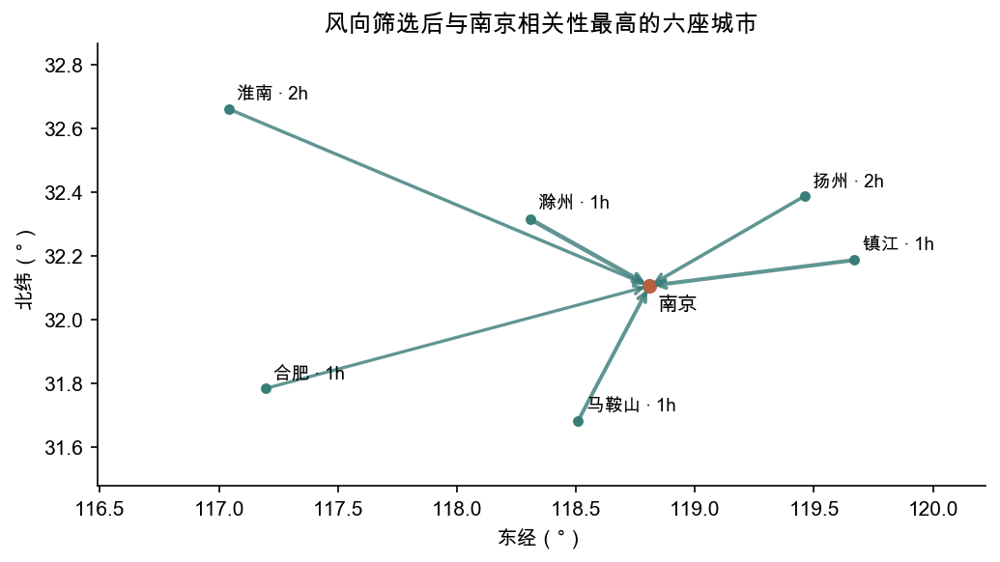

# 中国城市重污染日从哪里来？

独立实验执行报告　｜　2026 年 11 月 15 日

实测的 134 天里，长三角 41 城有 5,410 个合格城市日。其中 29 个日均 PM₂.₅ 超过 150 µg/m³，合并为 27 段同城连续过程。南京有 132 个合格日，最高日均浓度为 92.93 µg/m³。覆盖不连续，以上次数仅适用于已观测日期。

## 计划覆盖到哪里

研究计划见[项目计划书](项目计划书.pdf)。原十月试验保留独立核验；扩展版合并多个观测窗口，以下所有分母均按实际取得的数据计算。

**地面**　全国站点日文件 134/1,096。目前样本覆盖 2023-01-01 至 2023-04-01、2023-12-01 至 2023-12-12、2024-10-01 至 2024-10-31。另有 2025 年 11 月 26—27 日城市级沙尘案例，单列 PM₁₀，不增加站点日文件计数。

**ERA5**　长三角 41 个城市代表点共 1,078,464 城市小时，风速、风向、气温、地面气压齐全。边界层有效 899,376 城市小时，北京时间 2024 年 1 月 1 日 08 时至 7 月 1 日 07 时连续缺测。原十月五变量网格按 UTC 整月提供，在北京时间从 10 月 1 日 08 时起。计划要求的东部全网格三年资料仍缺；代表点缺口没有插值填补。

**Sentinel-5P**　2023 年一季度有连续 90 份 KNMI 日级 L3 区域数组；另有 2024 年 10 月 1 日一对 L2 柱浓度及 QA 栅格。L2 缺该轨的像元时标，其余日期的东部逐轨 L2 尚待采集。当前 KNMI 同系列公开说明覆盖至 2023 年 11 月，2024—2025 需用相应 L2 产品。

**FIRMS 和地图**　2019—2025 每年三颗传感器的中国年表均已校验，共 21 份。OSM 有 2026 年 11 月快照，全国与沪苏浙皖分省文件空间重叠。模型用道路和工业面，抽样另用行政区面、已标注农田面。2026 年地图只作回顾性参照。

地面与 L3 按日，气象按代表点城市小时作分母。FIRMS 的 21 份年表齐备；OSM 是单次快照。 2023—2025 年全国站点、长三角 41 城 ERA5 与东部 KNMI 卫星窗口。颜色表示每月覆盖比例（0 到 1）。

## 三个问题为什么需要跨源观测？

火点的位置无法说明烟羽经过哪座城市；需要把风向、上下风城市实测浓度和农田面配在同一时空范围。卫星测到的是整层大气柱；必须用地面实测检验预测误差，并加入边界层和风速。连续高浓度可以从站点识别；要比较过程的气象条件和春节时段，还需要同期风场与假期日历。

图示给出观测来源、每个问题使用的关联键和最终分析单位。地图来自 © OpenStreetMap contributors。

## 站号合并与抽样核验

2,026 个输入站号中，1,960 个归入城市。其余包括 65 个名录缺失和 1 个城市冲突（2591A）。已把海门、江阴、昆山等县级旧名归到研究期地级市；跨名录坐标相差超过 10 公里的 9 个站点已保留差值，历史迁址日期有待核实。至少一个分析指标有值的不同站号=1662，站点小时行=5088095，PM2.5非空=5039719，NO2非空=5044151。

| 站点抽样结论 | 条数 |
| --- | --- |
| 名称一致 | 186 |
| 无可核对站点归属 | 10 |
| 区代码支持城市归属 | 3 |
| 边界缺失 | 1 |

随机种子 20261115。从原表头的 2,026 个站号抽 200 个，包括无名录的站号；其中 186 个直接得到行政区名称支持，3 个由福建省县区代码追溯至厦门、漳州。站点样本共 189/200 有市级证据，或 189/190 个有坐标站点。火点沿用归档固定的 200 个时空格，全部重新算回原始小格；196 个匹配到 OSM 地级边界，另 1 个可定位到直辖市重庆，3 个缺可用行政边界。2 个格的四角跨地级边界。全国抽样的 200 个火点格中心均未命中 OSM 已绘制农田，地图空白与真实非农田无法区分。地图逐条浏览文件在 [400 条样本的逐条读图页](400条地图抽样复核.html)。以上为计算机空间核验与区划资料复查，计划书要求的逐条人工读图尚待完成。

## 问题一　火点之后，上下风城市的浓度如何变化

子问：这种上下风差异在随后两天怎样变化？同事件配对补验显示，第 12 小时较第 6 小时多 2.14 µg/m³，较第 24 小时多 3.30 µg/m³，两项差值区间均跨零。五个时点中第 12 小时点估计最大，尚不能确定峰值时刻。

原始全国火点 6,977,065 条，归档清洗后保留 4,086,779 条，合并为 3,322,855 个 0.01° × 30 分钟格。以研究日期及华东窗口筛得 36,852 个格时，排除曾出现固定热源标记的同位置小格后剩 34,527 个，372 个中心命中已绘制农田。独立十月处理程序的宽口径质控计数还含跨北京时间年界的记录；主模型使用同一套归档事件表。

锚点要求同一 0.25° 格、同一小时至少有两个不同火点小格。用 50 公里内最近城市的风向确定上下风，以 30—200 公里、45° 扇区、风速至少 1 m/s 筛选；比较各城相对事件前 24 小时自身基线的增幅。五个滞后都有上下风样本的共同锚点有 811 个、跨 75 日。第 12 小时的平均差为 +9.61 µg/m³，按锚定日自举的 95% 区间为 [2.08, 18.15]。限定两个火点格中心在农田面中后仅 12 个共同锚点，第 12 小时为 +4.48，区间 [-8.59, 17.16]。这组数据无法识别实际作物、秸秆燃烧或因果贡献率。

相同锚点用于所有滞后。点为平均差，误差线为按锚定日期分组自举区间，单位 µg/m³。 FIRMS、ERA5、地面站和 OSM 在实际重合的观测日期对齐，共同锚点跨 75 个日期。

全国 FIRMS 取长三角周边火点，地面来自 CNEMC 公开日档。圆点为城市代表点；该月长三角没有达本研究阈值的城市日。 坐标单位为度，城市颜色表示 2024 年 10 月最高日均 PM₂.₅（µg/m³）。

## 问题二　气象能否改善地面 NO₂ 预测

41 城 × 90 天共有 3,690 个候选城市日，L3 有效 2,014 个，与地面、气象及 OSM 对齐后剩 1,946 个，跨 81 个日期及 37 个卫星格。卫星柱单位为 10¹⁵ molecules/cm²，地面单位为 µg/m³。有效地方太阳时按 24 × 时间比例 + 8 − 经度/15 换算北京小时，另做 ±1 小时敏感性。随机抽查 200 条，从 NPZ 独立复算其格点、时刻、柱浓度。L3 时刻代表格内有效观测。十月 L2 只有轨道起止时刻，使用 QA > 75% 的浓度，仅保留轨道起、止整点配对的敏感性结果。L2 的逐像元 UTC、L3 的有效地方太阳时和地面小时各自保留。

| 留出方式 | 特征 | 测试观测 | MAE (µg/m³) | 测试 R² |
| --- | --- | --- | --- | --- |
| 留出卫星格点 | 卫星 | 1946 | 6.20 | 0.41 |
| 留出卫星格点 | 卫星+气象 | 1946 | 5.52 | 0.52 |
| 留出卫星格点 | 卫星+气象+OSM | 1946 | 5.53 | 0.52 |
| 留出3月 | 卫星 | 673 | 5.81 | 0.32 |
| 留出3月 | 卫星+气象 | 673 | 6.74 | 0.16 |
| 留出3月 | 卫星+气象+OSM | 673 | 6.67 | 0.17 |

按卫星格点留出时，加入气象后误差降低。在 1—2 月训练、3 月测试时误差上升，因此不能将空间留出的改善当作跨月预测能力或气象的因果解释比例。

同柱浓度四分位内比较。横轴为 ERA5 边界层高度，纵轴为与 L3 有效时刻对齐的地面浓度。 2023 年 1—3 月，共 1,946 个城市日，卫星来源为 KNMI，地面来源为 CNEMC。

## 问题三　长三角重污染过程与春节

| 样本 | 区域 | 合格城市日 | 有合格记录城市数 | 重污染城市日 | 最高城市日均PM25 |
| --- | --- | --- | --- | --- | --- |
| 全部 | 全国 | 44522 | 338 | 745 | 415.81 |
| 全部 | 长三角41城 | 5410 | 41 | 29 | 208.19 |
| 全部 | 南京 | 132 | 1 | 0 | 92.93 |
| 2023年归档日期 | 全国 | 34051 | 338 | 722 | 415.81 |
| 2023年归档日期 | 长三角41城 | 4140 | 41 | 29 | 208.19 |
| 2023年归档日期 | 南京 | 101 | 1 | 0 | 92.93 |
| 2024年10月 | 全国 | 10471 | 338 | 23 | 178.13 |
| 2024年10月 | 长三角41城 | 1270 | 41 | 0 | 130.31 |
| 2024年10月 | 南京 | 31 | 1 | 0 | 51.46 |

城市日由站点小时先作城市均值，日均至少有 20 个有效小时，严格大于 150 µg/m³ 才入选。城市间无站数加权。全国观测到 745 个超阈值城市日和 437 段同城连续过程。相邻日缺测时的过程边界已标记。长三角 27 段中 26 段具备聚类所需的风速、边界层、上风城市前期 PM₂.₅。两组都出现较高的上风浓度。把组间差别解读为气象条件差异，现有观测不能给出本地累积和跨城传输各自的比例。

| 组 | 风速 m/s | 边界层 m | 上风前6小时 PM₂.₅ | 过程数 |
| --- | --- | --- | --- | --- |
| 0.00 | 3.36 | 416.33 | 150.99 | 14 |
| 1.00 | 2.04 | 208.46 | 150.36 | 12 |

| 年 | 窗口 | 起 | 止 | 应有日期数 | 实有日期数 | 长三角合格城市日 | 平均PM25 | 重污染城市日 |
| --- | --- | --- | --- | --- | --- | --- | --- | --- |
| 2023 | 节前7日 | 2023-01-14 | 2023-01-20 | 7 | 7 | 287 | 37.52 | 0.00 |
| 2023 | 春节假期 | 2023-01-21 | 2023-01-27 | 7 | 7 | 287 | 42.44 | 3.00 |
| 2023 | 节后7日 | 2023-01-28 | 2023-02-03 | 7 | 7 | 286 | 41.09 | 0.00 |
| 2024 | 节前7日 | 2024-02-03 | 2024-02-09 | 7 | 0 | 0 | 缺数据 | 缺数据 |
| 2024 | 春节假期 | 2024-02-10 | 2024-02-17 | 8 | 0 | 0 | 缺数据 | 缺数据 |
| 2024 | 节后7日 | 2024-02-18 | 2024-02-24 | 7 | 0 | 0 | 缺数据 | 缺数据 |
| 2025 | 节前7日 | 2025-01-21 | 2025-01-27 | 7 | 0 | 0 | 缺数据 | 缺数据 |
| 2025 | 春节假期 | 2025-01-28 | 2025-02-04 | 8 | 0 | 0 | 缺数据 | 缺数据 |
| 2025 | 节后7日 | 2025-02-05 | 2025-02-11 | 7 | 0 | 0 | 缺数据 | 缺数据 |

2023 年春节三段长三角样本分别为 287、287、286 个城市日，节中日均 PM₂.₅ 高于节前。2024 和 2025 年原始站点日档未覆盖节期。上海市生态环境局另报告 2024 年春节出现 1 个重度污染日；2025 年除夕至元宵的 16 日平均 PM₂.₅ 为 33 µg/m³、优良率 100%。两种春节时间口径已单独存档，未混入 8 天法定假期的统计。

取去趋势后小时差分、接收地风向及 1—6 小时滞后。相同样本内选择各城市最强滞后，属于探索性关联。 全国日档与 ERA5 的长三角匹配小时样本。经纬度单位为度，边的标注为小时。

## 真实体量与复现

| 来源 | 实际原始文件字节_同摘要去重 | 保守研究子集落盘字节 | 研究子集口径 |
| --- | --- | --- | --- |
| 地面 | 256657229 | 18511592 | 已匹配站号且PM₂.₅或NO₂有观测的站点小时，两列浓度各保留一次 |
| 火点 | 558827644 | 29067214 | 用于全国季节分布的七年去重火点时空格，排除原始年表和重复派生表 |
| 气象 | 72777381 | 813752 | 与长三角实测地面小时匹配的五个气象量 |
| 卫星 | 36843248 | 87626 | 长三角有效L3格日按同格去重，加不同日期的十月有效L2城市轨道 |
| 地图 | 1874655405 | 30769620 | 十月道路和工业地块的引用完整子集；其余快照、农业核验和行政区文件不累加 |

五源去除相同哈希后的原始输入共 2,799,760,907 字节。这一列仍含全国地图与四省地图的地理重叠、十月卫星整轨及不同尺度的气象导出。按实际使用的上述五个互不重复的研究子集取物理文件大小，保守合计 **79,249,804 字节**。原始输入与加工后压缩子集是两种口径；目前不足以验证课程的 2 GB 有效数据要求。中间表、图、辅助区划、归档 ZIP 和全球传输文件均未累加到有效量。

十月复跑与原试验所有汇总指标对齐，包括全国 23 个重污染城市日和 20 段过程。全国集合采用合并名录后的数值见上表。另从原始 CSV 独立复算南京 12 个随机日，逐城小时核对原十月气象，并通过 HTTP 断点拼接离线回归测试。运行环境、逐源清单、抽查明细和执行日志均随工程保存。

## 仍缺的数据和取得路径

地面尚缺 962 天，其中 2024 和 2025 年春节前后优先队列共 44 天。其次是其余冬季缺档 156 天。发布方提供年度站点 ZIP 和按日 CSV。早期批量续采的运行环境可检索发布页，批量下载路径无法连接这些外部原始数据主机。未启动会反复失败的旧任务。真实站点年度包可用 `scripts/import_station_zip.py` 校验导入。其余东部全网格 ERA5 和 L2 柱、QA、像元时标须能直连各发布服务。未使用付费服务。

公开仓库运行 `python reproduce.py` 可重建春节样例和三个问题的主要统计。`python visualization/redraw.py` 可重画五张图。联网采集计划和额外依赖见仓库数据来源页。

## 来源

[全国空气质量日档与年度包](https://quotsoft.net/air/) · [NASA 火点字段](https://www.earthdata.nasa.gov/sites/default/files/imported/VIIRS_activefire_User_Guide.pdf) · [KNMI L3 数据](https://temis.pmc.knmi.cloud/airpollution/no2col/cci-no2-tropomi.php) · [CEDA 有效太阳时字段](https://catalogue.ceda.ac.uk/uuid/f8a220b2ba184d89bc40028bc4a8b2e7/) · [Sentinel-5P L2 时间字段](https://sentinels.copernicus.eu/documents/247904/2474726/Sentinel-5P-Level-2-Product-User-Manual-Nitrogen-Dioxide.pdf) · [ERA5 代表点导出](https://open-meteo.com/en/docs/historical-weather-api) · [© OpenStreetMap contributors](https://www.openstreetmap.org/copyright) · [福建省民政厅区划代码](https://mzt.fj.gov.cn/gk/tzgg/202601/t20260105_7071220.htm) · [江苏省民政厅区划代码](https://mzt.jiangsu.gov.cn/art/2023/4/25/art_78635_10994579.html) · [上海市生态环境局春节答复](https://sthj.sh.gov.cn/hbzhywpt5333/20250711/2c80ae29acdb4c4fab947f136d03271b.html)。逐文件来源、哈希及研究窗口见工程内清单。

## AI 使用说明

ChatGPT / Codex 协助了采集脚本、站号归并、卫星时刻换算、建模、绘图和报告整理。用户指出日期写死、ERA5 目录错配和火点年份问题。本次从原始读数重建了春节一天的 984 个城市小时，重新训练了 18 组卫星模型，逐项检查输出。空间与时间留出所得误差方向相反，故只报告具体检验条件下的表现。成员的逐条人工读图和个人心得仍待补齐。详见[完整 AI 记录](https://github.com/gxm-nju/china-air-pollution/blob/main/AI_USAGE.md)。

## 公开仓库与复现材料

[gxm-nju/china-air-pollution](https://github.com/gxm-nju/china-air-pollution) 提供采集与处理代码、数据字典、代表性原始样本、校验清单、清洗与融合表、逐项结果及课堂展示。
