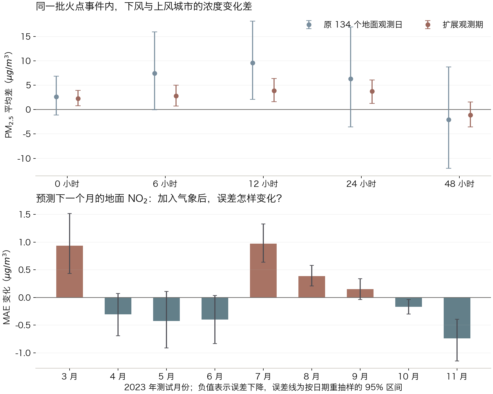

# 2023—2025 年地面补采与三问复算

2026 年 11 月 16 日完成。全国站点小时档覆盖全部 1,096 个日历日。旧 134 日结果独立保留，本次新增的 962 份站点日档均已校验并进入分析。补采以 [监测总站公开发布数据的逐站归档](https://quotsoft.net/air/) 为来源。首轮有 301 个请求因限流或代理超时失败，降速补漏后缺日集合为空。历史十月试验与中期展示继续用于基线对照。

## 读入的数据和真正进入计算的观测

| 口径 | 结果 |
|---|---:|
| 逐日站点 CSV，按 SHA-256 去重 | 1,096 份，1,998,769,634 字节；其中新增 1,742,112,405 字节 |
| PM₂.₅、NO₂ 两种小时浓度所在的原始 CSV 行 | 51,996 行，257,074,351 字节，含所有站列与字段 |
| 实际进入城市均值的有效站点小时值 | PM₂.₅ 40,257,927 个；NO₂ 40,317,913 个；数字文本合计 146,138,811 字节，未计键、分隔符等 |
| 至少一项有值的全国城市小时 | 8,694,152 |
| 至少一城有 20 个有效 PM₂.₅ 小时的日期 | 1,077 日；另 19 天虽有文件，全都达不到城市日门槛 |
| 全国 / 长三角合格城市日 | 361,867 / 44,115 |

原始整档、所选行和实际数值字节是同一批资料的三种计量方式，不相加。下载成功、通过日均质量门槛、参与具体模型各有分母。课程要求的原始有效总量和各源门槛还须分别举证。全国全指标站点文件、全球卫星传输量和重复派生表不能直接相加作为达标证明。此前的单日 MERRA-2 案例未纳入这三项主分析。

[逐日分析输入与 SHA-256](分析输入逐日清单.csv) · [逐日覆盖与区域共现](三年逐日覆盖与区域共现.csv) · [采集尝试及失败原因](逐次采集.jsonl) · [监工核验记录](监工核验/监工记录.md)

## 火点与上下风 PM₂.₅

| 同一批事件的比较 | 原 134 日基线 | 三年地面档 |
|---|---:|---:|
| 五个时点均有上下风观测的火点网格小时 | 811，分布在 75 天 | 4,299，分布在 619 天 |
| 第 12 小时下风减上风的变化差，µg/m³ | +9.61 [2.08, 18.15] | +3.91 [1.64, 6.38] |
| 至少两个火点小格中心命中已绘农田 | 12 个 | 51 个 |
| 上述农田子组第 12 小时变化差，µg/m³ | +4.48 [−8.59, 17.16] | +4.37 [−0.46, 9.51] |

方括号为按事件日期重抽样的逐时点 95% 区间。第 12 小时的区间宽度从 16.07 缩至 4.74 µg/m³，估计的平均差也减小。新样本中第 12 小时比第 6 小时多 1.09（逐对区间 −0.65 至 2.61），比第 24 小时多 0.15（−2.16 至 2.63）；不能锁定峰值。

三年 6 月和 10—11 月共 273 天都有地面日档。这个日历窗口的共同火点网格小时从 76 增至 1,241，其中 21 个命中上述农田口径。在同期长三角 10,898 个合格城市日中，PM₂.₅ 日均严格超过 150 µg/m³ 的记录为零。短时浓度变化可以观察，来源贡献率仍不能据此识别。收获日因地点和作物而异，日历窗口和农田图层都不提供某次燃烧的物料标签。

[时点及区间](火点相同锚点对照.csv) · [同事件配对比较](配对时点差.csv) · [收获期窗口与分年结果](收获期参考窗口.csv)

## 长三角重污染过程与春节

长三角有 **159 个超阈值城市日**，集中在 **34 个日期**；旧样本分别为 29 和 8。按城市合并连续超阈值日后是 **120 段同城过程**，原为 27 段。有效观测中，2023、2024、2025 年分别有 89、50、20 个超阈值城市日。南京有 1,077 个合格日，最高 129.16 µg/m³，未触发研究阈值。

以 GDEX 的 ERA5 同网格边界层高度补 2024 年的缺测，取得区域窗口 12,372,984 字节。984 个重叠城市小时与旧数据的平均绝对差为 1.26 米。实际有 178,685 个地面匹配城市小时用到补值，36 段进入分类的过程用到新数据。最终 120 段中 116 段可用于聚类：76 段平均风速 2.14 m/s、边界层 246 米；40 段平均风速 3.41 m/s、边界层 424 米。两组上风前期浓度都较高（140.60、149.22 µg/m³），这些分组描述气象情形，尚不能推出本地排放与外来输送的份额。

| 年 | 节前七天 | 春节假期 | 节后七天 | 假期超阈值城市日 |
|---|---:|---:|---:|---:|
| 2023 | 37.52 | 42.44 | 41.09 | 3 |
| 2024 | 62.15 | 55.15 | 24.99 | 22 |
| 2025 | 52.06 | 56.28 | 30.18 | 3 |

表中为长三角合格城市日的 PM₂.₅ 均值（µg/m³）。2023 年假期 7 天，另两年 8 天。与各自节前七天相比，两个年份上升，一个年份下降。每年只保留三个窗口每天都合格的同一批城市，方向一致；三年结果供描述，不作节日因果估计。

[逐次过程](全国重污染过程.csv) · [逐年地区分母](分年地区汇总.csv) · [同一批城市的春节对照](春节三窗口共同城市.csv) · [ERA5 区域请求清单](原始区域窗口清单.csv)

## 卫星估计地面 NO₂ 的跨月验证

在旧 90 天基础上补入 240 个区域日窗。同版本 KNMI FV2.0 日产品的研究期可用范围是 2023 年 1 月 1 日至 11 月 26 日；2024、2025 年没有计入本模型。[产品目录](https://temis.pmc.knmi.cloud/airpollution/no2col/cci-no2-tropomi.php)

330 个区域日窗共 5,252,920 字节，新增 3,845,157 字节。经质量、时刻、地面、气象与空间匹配，**6,933 个城市日**来自 **307 个日期、6,223 个不同的有效卫星格日**。每次只用此前月份训练，再预测下一个月份。覆盖 2023 年 3—11 月的九次检验中，加气象后 4、5、6、10、11 月误差下降；3、7、8、9 月误差上升。按测试日期配对重抽样，单月区间中，10、11 月的改善和 3、7、8 月的变差与零有区别；其他四个月的区间跨零。三月的表现不能代表所有月份，这一年的结果也不足以确定多年季节规律。

[九个月的样本与误差](滚动留出月指标.csv) · [各月误差差值与区间](各月加入气象的配对误差变化.csv) · [逐月样本损耗](按月样本覆盖.csv)

## 核验与复现

独立核验者全量比对逐日输入哈希、两种指标的有效读数与城市小时表，另按每月一个样本日抽查南京、阜阳、上海的正午均值，共 36 天、216 项。多源核对比较事件明细、逐日过程与逐月预测。研究者个人核验可从日期清单选样独立重算；上述记录属于程序与独立代理核验。

在仓库既有 Python 环境中运行 `python 三年地面扩展/复核结果.py`，可从随包的全国城市日、火点时点明细和卫星样本表检验地区结果、Q1 均值及样本数、重新拟合 27 组月度预测指标。`绘制结果图.py` 从结果表绘图。从原始数据重建需要原工程输入目录、日档及运行依赖；[补采与分析脚本包](全工程补采与分析脚本.zip)保留原工程相对路径。[监工核验](监工核验)
