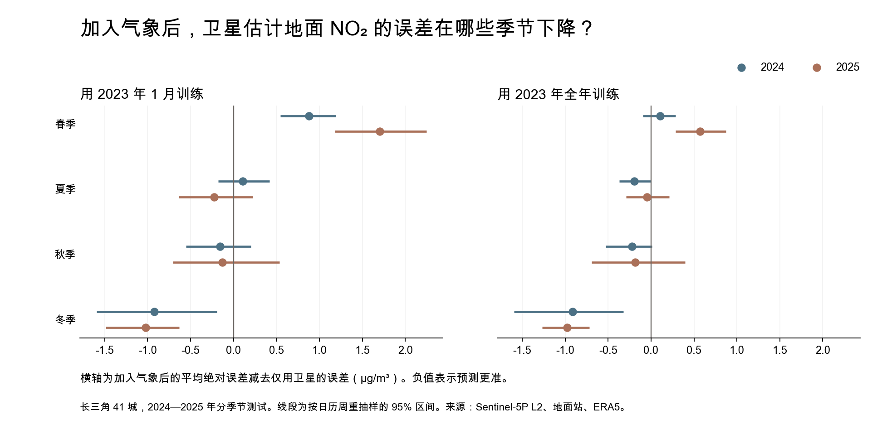

# 长三角卫星 NO₂ 跨季节验证

验收日期 2026-11-16。长三角 41 城，2023 年 1 月至 2025 年 12 月。核对 36 份月目录，1,695 个候选轨道，1,694 轨完成读取和核验。其中 6 轨在矩形内没有像元，1,688 份非空区域文件进入筛选，另缺 1 轨。旧三个一月结果独立保留。

**第二题的结论。** 仅用 2023 年 1 月训练，之后两年的冬季加入气象均降低了误差，春季均增加了误差。两个夏季和两个秋季的按周区间都跨零。改用 2023 全年训练，2024 夏季有小幅改善，2025 夏季和两个秋季的区间都跨零。冬季看到的收益有明显的季节差异。详细差值见下表。

## 从过境像元到地面测试样本

仅在 28—35°N、115.5—122.5°E 保留像元中心落入矩形的观测。使用对流层 NO₂ 柱、质量标记、经纬度、行列和真实扫描时间，按轨道标识及文件 SHA-256 检查重复。19,346,209 个区域像元中，9,017,775 个通过 QA > 0.75 且柱浓度有效，510,439 个合格轨道像元落在城市代表点 15 公里内，同一像元被多城选中时在这项计数中只计一次。每座城市每天取有效像元数最多的一轨，产生 26,718 个卫星城市日。连接地面 NO₂、逐小时网格风与边界层后，实际建模 26,229 个城市日，覆盖 1025 天。

|年份|建模城市日|实际日期|城市数|用途|
|---|---:|---:|---:|---|
|2023|8,804|350|41|训练|
|2024|8,499|342|41|独立测试|
|2025|8,926|333|41|独立测试|

每城每轨的柱浓度为合格像元等权均值，扫描时刻取中位数。过境转为北京时间，地面 NO₂ 取最近整点；ERA5 对代表点双线性插值，按过境时间线性插值。15 公里圆在区域边界外的部分没有取数。NO₂ 柱从 mol/m² 换成 10¹⁵ molecules/cm²；预测和误差单位均为 µg/m³。卫星和地面缺测时，该城市日不进入比较。

## 仅用一个冬月训练，和用全年训练，有什么区别？

分别用 2023 年 1 月、2023 全年的资料拟合标准化岭回归（α=1），测试使用 2024、2025 年。每个训练集各拟合仅用卫星柱浓度、柱浓度加风速和 log(1+边界层高度) 两个模型。标准化只拟合训练集，测试年份从未参与定参。季节按测试年的 3—5、6—8、9—11 和 1、2、12 月划分。冬季合并同一日历年的三个月。各季节先汇集同一批城市日再计算 MAE。差值为加入气象后的 MAE 减去仅用卫星的 MAE，负数表示预测更准。区间按日历周分组自助重抽样 3,000 次；逐日重抽样区间另存表中。各季节区间用于描述，未作多重比较校正。

|测试年与季节|城市日|有效日期|一月训练 MAE|一月训练差值 [95% 区间]|全年训练 MAE|全年训练差值 [95% 区间]|
|---|---:|---:|---:|---:|---:|---:|
|2024 春|2,169|87|4.16 → 5.03|+0.88 [+0.55, +1.19]|4.07 → 4.17|+0.10 [-0.09, +0.29]|
|2024 夏|2,339|89|3.60 → 3.70|+0.11 [-0.18, +0.42]|3.84 → 3.64|-0.20 [-0.37, -0.01]|
|2024 秋|2,027|87|3.95 → 3.79|-0.16 [-0.55, +0.20]|3.75 → 3.53|-0.22 [-0.53, +0.01]|
|2024 冬|1,964|79|7.90 → 6.98|-0.92 [-1.59, -0.19]|7.54 → 6.63|-0.92 [-1.60, -0.32]|
|2025 春|2,261|83|3.93 → 5.63|+1.70 [+1.18, +2.25]|3.79 → 4.36|+0.57 [+0.29, +0.87]|
|2025 夏|2,197|81|3.67 → 3.44|-0.23 [-0.64, +0.22]|4.01 → 3.97|-0.04 [-0.29, +0.21]|
|2025 秋|1,998|85|4.33 → 4.20|-0.13 [-0.71, +0.53]|4.21 → 4.03|-0.19 [-0.69, +0.40]|
|2025 冬|2,470|84|7.60 → 6.58|-1.03 [-1.49, -0.63]|7.18 → 6.21|-0.98 [-1.27, -0.72]|



## 全年外推及适用范围

- 用 2023 全年训练后，对 2024 全年 8,499 个城市日，MAE 从 4.732 变为 4.441 µg/m³，差值 -0.292，按测试日期重抽样的 95% 区间 [-0.417, -0.170]。
- 用 2023 全年训练后，对 2025 全年 8,926 个城市日，MAE 从 4.880 变为 4.702 µg/m³，差值 -0.178，按测试日期重抽样的 95% 区间 [-0.344, -0.010]。

这是对真实过境附近且云筛选通过的城市日的同期估计，不能代表所有阴天和夜间。年际变化也包含卫星处理版本、有效样本和天气背景的差异。模型回答地面 NO₂ 监测问题，无法估算 PM₂.₅ 的排放来源份额。

## 体量与采集核验

- 三年区域 L2 提取文件累计 **196,276,931 字节（196.28 MB）**。相对课程 200 MB 单源参考线的差额为 +3.72 MB（正值为尚缺）。其中有 1,341 轨实际贡献了最终保留的城市日，这些轨道的整份区域文件合计 181.72 MB；每轨用于城市匹配的像元只是文件的一部分。
- 旧 L3/试验文件账为 40,688,405 字节，含 330 份 L3 区域日窗 5,252,920 字节。旧档与三年 L2 简单加和的文件量上界为 236.97 MB。部分源自相同观测，相关范围也不同。全球原始整轨、HTTP 传输、模型表和同文件的副本均未计作新增有效量。
- 轨道来自 Copernicus Data Space 官方目录，以对应日期、轨道及产品标识匹配 MEEO 原文件。2023-03-10 的一个 .nc 对象实际为 ZIP，改为从存储成员按范围取数。2024-03-22 一份镜像截断，使用 Microsoft Planetary Computer 的同名官方产品；另有镜像缺失情况也按同名产品核对。文件清单保留实际来源的公开 URL，不保留临时签名。
- 来源未齐：S5P_OFFL_L2__NO2____20241003T045304_20241003T063434_36133。缺失轨道没有进入任何模型。
- 备用公开镜像成功取得 18 份。时间戳、地理范围、行列索引唯一性、QA 范围、逐轨字节和摘要均通过程序核对。滚动下载的月清单保留；个别区域轨道没有合格城市像元，覆盖表单列。[独立抽查原始像元](记录/独立抽样核验.md)。

## 复现与结果表

从公开仓库根目录离线重训。使用 Python 3.12、numpy 1.26.4、pandas 2.2.2、scipy 1.13.1、scikit-learn 1.5.1。复算从公开的逐城市日融合表开始，输出到新的目录。

```bash
python 非一月卫星补采_验收/程序/no2_multiseason.py --matched 非一月卫星补采_验收/结果/卫星城市日匹配.csv.gz --output reproduced/跨季节
```

从区域原始输入重建时，在完整工程的扩展实验下保留本目录及上一阶段的“网格与过境复算”。先按上一阶段说明恢复三个一月及 ERA5，保留三年地面扩展得到的逐城市小时表。用本目录的 程序/continue_months.py 按清单恢复非一月轨道，再依次运行 audit_inputs.py、no2_multiseason.py、verify_results.py 和 season_figure.py。下载还使用 requests 2.32.3、h5py 3.11.0，读取地面表使用 pyarrow 24.0.0。POLLUTION_PROJECT_ROOT 可指向存有三年地面中间表及城市坐标的工程。

[非空区域文件清单](记录/最终逐轨核验.csv) · [区域内无像元的轨道](记录/区域无像元轨道.csv) · [36 个月筛选和匹配分母](结果/逐月有效样本.csv) · [季节误差及两种区间](结果/跨季节误差.csv) · [季节配对预测](结果/季节配对预测.csv.gz) · [逐月和全年误差](结果/NO2验证.csv) · [数值核验](记录/结果核验.json) · [目录中尚缺的轨道](记录/未完成项.json)

[Copernicus 官方目录](https://dataspace.copernicus.eu/) · [MEEO 开放档案](https://registry.opendata.aws/sentinel5p/) · [Microsoft Planetary Computer](https://planetarycomputer.microsoft.com/dataset/sentinel-5p-l2-netcdf) · [项目 GitHub](https://github.com/gxm-nju/china-air-pollution)

[缺失轨道的同名原档及续接方法](记录/缺轨说明.md)
